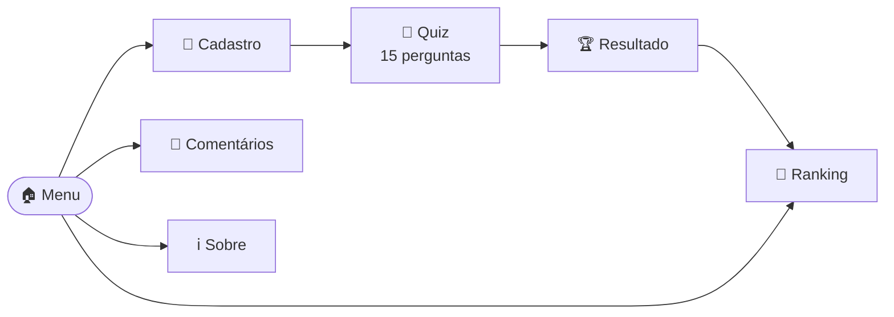
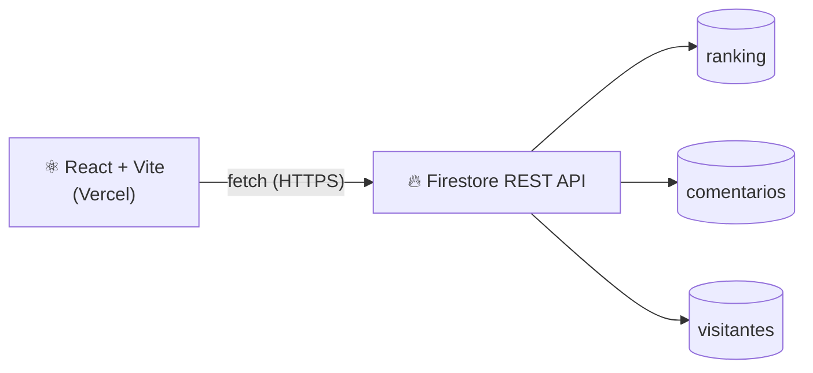

<div align="center">



<br />

[](https://quiz-fisio-quest.vercel.app/)

<br />


<br />

<a href="#-sobre-o-projeto">Sobre</a> ·
<a href="#-como-funciona">Como funciona</a> ·
<a href="#-funcionalidades">Funcionalidades</a> ·
<a href="#-arquitetura">Arquitetura</a> ·
<a href="#-rodando-localmente">Rodar</a> ·
<a href="#-Desenvolvedor">Desenvolvedor</a>

</div>

---

## 📗 Sobre o projeto

Estudar Fisioterapia costuma significar reler resumos e slides, e é difícil saber se o conteúdo realmente ficou.

O **FisioQuest** transforma essa revisão em um jogo rápido: você responde perguntas de Anatomia, Fisiologia, Histologia, Biofísica, Embriologia e outras disciplinas, vê na hora se acertou, recebe um status do seu desempenho e disputa posição no **ranking compartilhado** com a turma.

---

## 🎮 Como funciona



1. **Cadastro:** o jogador informa nome e disciplina.
2. **Perguntas sorteadas:** a cada partida são 15 perguntas, sendo **5 fáceis, 5 médias e 5 difíceis**, embaralhadas. Cada jogo é diferente do anterior.
3. **Feedback imediato:** após cada resposta, o jogo mostra se o jogador acertou e qual era a alternativa correta.
4. **Resultado com status:** o desempenho final recebe uma classificação.
5. **Ranking:** os melhores resultados aparecem em um pódio, com o top 20 da turma.

| Acertos | Status |
| :-----: | :----- |
| 0 a 4 | 📚 Ixi! Precisa estudar um pouco mais. |
| 5 a 7 | 🙂 Bom! Mas pode melhorar. |
| 8 a 14 | 👏 Muito bom! |
| 15 | 🏆 Espetacular! Você zerou o game! |

<!--
Quando tiver as capturas de tela, salve em docs/screenshots/ e tire os marcadores
de comentário deste bloco para exibir a galeria.

## 📸 Capturas de tela

<p align="center">
  
  
  
  
</p>
-->

---

## ✨ Funcionalidades

| | Recurso | Detalhes |
| :-: | :-- | :-- |
| 🎬 | **Menu animado** | Logo flutuante, entrada em cascata e botão "Jogar" pulsando. Respeita a configuração "reduzir movimento" do dispositivo. |
| 🧠 | **Quiz sorteado** | Banco de perguntas em três níveis de dificuldade, com sorteio a cada partida. |
| ✅ | **Feedback imediato** | Mostra o acerto ou erro logo após cada resposta. |
| 🏅 | **Status de desempenho** | Mensagem personalizada de acordo com a pontuação final. |
| 🥇 | **Ranking com pódio** | Top 20 compartilhado entre todos os jogadores, com destaque para os 3 primeiros. |
| 💭 | **Comentários** | Os jogadores deixam uma reação em emoji e um comentário sobre o jogo. |
| 👀 | **Contador de visitantes** | Conta pessoas únicas, uma por dispositivo, mesmo que voltem várias vezes. |
| 🛡️ | **Tratamento de erros** | Tela amigável com botão de recarregar, em vez de uma tela branca. |
| 📱 | **Responsivo** | Layout pensado para celular e adaptado para desktop. |

---

## 🧱 Arquitetura



A camada de dados fica isolada em `src/firebase.js`, e os componentes só chamam funções como `carregarRanking()` e `salvarResultado()`. A interface não sabe como o Firestore funciona por dentro.

### 🔧 Decisões técnicas

| Problema encontrado | Solução adotada |
| :-- | :-- |
| O SDK oficial do Firebase usa conexões de longa duração, que alguns firewalls e antivírus bloqueiam. O jogo não conseguia salvar nada. | Chamadas diretas à **REST API do Firestore** com `fetch`. É HTTPS simples e funciona em qualquer rede. |
| Uma requisição travada deixava o botão em "Salvando..." para sempre. | **Timeout de 10 segundos** com `AbortController` em toda chamada de rede. |
| Uma falha ao salvar passava despercebida. | `salvarResultado` e `salvarComentario` retornam `{ sucesso, ... }`, e a tela **avisa o jogador** quando o envio falha. |
| Um erro inesperado derrubava a página inteira. | `ErrorBoundary` exibe uma tela de recuperação com botão **Recarregar página**. |
| As regras de teste do Firestore têm data de expiração. | **Regras permanentes**, com validação de campos, configuradas no Console do Firebase. |
| Um clique duplo no último botão salvava o resultado duas vezes. | Trava de envio (`enviando`) no componente do Quiz. |

---

## 🚀 Rodando localmente

**Pré-requisito:** [Node.js](https://nodejs.org) 18 ou superior.

```bash
# 1. Clone o repositório
git clone https://github.com/PHYMatheus/Quiz-FisioQuest.git

# 2. Entre na pasta
cd Quiz-FisioQuest

# 3. Instale as dependências
npm install

# 4. Inicie o servidor de desenvolvimento
npm run dev
```

Abra `http://localhost:5173` no navegador.

Para gerar a versão de produção:

```bash
npm run build
```

---

## 📁 Estrutura do projeto

```text
Quiz-FisioQuest/
├── docs/
│   └── banner.svg              # banner animado deste README
└── src/
    ├── assets/
    │   └── logo.png            # logo exibida no menu
    ├── components/
    │   ├── Menu.jsx
    │   ├── Cadastro.jsx
    │   ├── Quiz.jsx
    │   ├── Resultado.jsx
    │   ├── Ranking.jsx
    │   ├── Comentarios.jsx
    │   ├── Sobre.jsx
    │   └── ErrorBoundary.jsx
    ├── data/
    │   └── perguntas.js        # banco de perguntas
    ├── App.jsx                 # controla a navegação entre telas
    ├── firebase.js             # camada de dados (Firestore via REST)
    ├── theme.js                # paleta de cores
    ├── index.css               # estilos globais e animações
    └── main.jsx
```

---

## ✏️ Personalização

<details>
<summary><b>Adicionar ou editar perguntas</b></summary>

<br />

As perguntas ficam em `src/data/perguntas.js`. Cada pergunta segue este formato:

```javascript
{
  id: 99,                        // número único
  dificuldade: "medio",          // "facil" | "medio" | "dificil"
  tema: "Anatomia",
  imagem: "🦴",                  // emoji exibido acima da pergunta
  texto: "Qual é o maior osso do corpo humano?",
  alternativas: ["Tíbia", "Fêmur", "Úmero", "Rádio"],
  correta: 1,                    // posição da alternativa correta (começa em 0)
}
```

> Mantenha pelo menos **5 perguntas em cada nível de dificuldade** para que toda partida tenha 15 perguntas.

</details>

<details>
<summary><b>Trocar cores, logo e integrantes</b></summary>

<br />

- **Cores:** edite `src/theme.js`.
- **Logo:** substitua `src/assets/logo.png`.
- **Integrantes e texto do "Sobre":** edite `src/components/Sobre.jsx`.

</details>

---

## ☁️ Publicação

O projeto é publicado na [Vercel](https://vercel.com), com deploy automático a cada `git push` na branch `main`.

| Configuração | Valor |
| :-- | :-- |
| Framework | Vite (detectado automaticamente) |
| Build command | `npm run build` |
| Output directory | `dist` |
| Variáveis de ambiente | Nenhuma necessária |

---

## 👥 Desenvolvedor

| Nome | Contribuição | GitHub |
| :-- | :-- | :-- |
| **Matheus** | Desenvolvimento/Criação | [@PHYMatheus](https://github.com/PHYMatheus) |

---

<div align="center">

Feito com 💚 para a turma de Fisioterapia

⭐ Gostou do projeto? Deixe uma estrela no repositório!

</div>